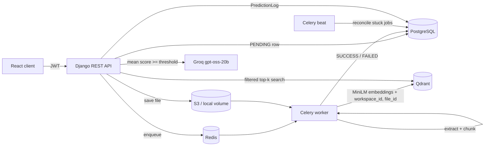

# Arishem

A multi-tenant retrieval-augmented generation (RAG) backend. Teams upload documents
and recordings into isolated workspaces, then ask questions that are answered only
from their own files, with citations. Questions the documents can't answer are
refused on a retrieval-confidence check instead of being answered from the model's
own knowledge.

**Stack:** Django REST Framework · Celery + Redis · Qdrant · sentence-transformers
(`all-MiniLM-L6-v2`) · Groq (`openai/gpt-oss-20b`) · PostgreSQL · S3 · React + TypeScript

[](https://github.com/abhishekkamble12/Arishem/actions/workflows/django.yml)

---

## Measured, not claimed

Every number below traces to a recorded run. Anything not listed has not been
measured, and this README does not claim it.

| | |
|---|---|
| Answer correctness, hard suite | **51 of 53** answerable questions fully correct (97% of required facts), over distractors, multi-hop and paraphrase — [evals/SCORECARD.md](evals/SCORECARD.md) |
| Faithfulness (RAGAS), hard suite | **0.958** over 52 answers, judged by a different model family; 2 of the 3 low scores are judge errors on very short answers, found by reading them |
| Unanswerable questions declined | **8 of 8** measured so far, with **0** invented answers; 1 of 53 answerable questions wrongly declined |
| Prompt injection | **2 of 2** resisted: a document instructing the model to misreport expense limits did not change the answer |
| Deployed and tested on AWS | **32/32 checks** over the network on a live stack — health, sign-up, per-workspace roles, S3 upload and ingestion, cited answers, refusal, cross-tenant isolation, token accounting, deletion — then torn down. [docs/DEPLOYMENT_VERIFICATION.md](docs/DEPLOYMENT_VERIFICATION.md) |
| Tests | **158** backend tests and **28** for the evaluation's own scoring rules and golden set, all offline, all in CI |
| Query latency | **median 2.46 s, worst 5.37 s** over six queries in the production container, measured while Groq was rate-limiting the primary model; ~2.1 s of it is the three Groq calls |
| Tokens per answered query | **1,041 in + 449 out** on the deployed system |
| Deployment cost | **~\$14.69/month** on AWS, from live Pricing API rates — see [docs/DEPLOY.md](docs/DEPLOY.md) |

---

## What it does

| Area | Implementation |
|---|---|
| **Ingestion** | `POST /upload-direct` stores the file under `ws_<id>/<uuid>_<name>`, records it as `PENDING`, enqueues a Celery task and returns `202`. The worker extracts text (PyMuPDF / docx2txt / Unstructured, or Whisper for audio & video), chunks it (800 chars, 150 overlap), embeds it and writes it to Qdrant. |
| **Querying** | The question is embedded and searched in Qdrant, filtered to the caller's workspace. If the mean similarity of the top-k chunks is below a threshold (default 0.065, calibrated on the golden set), the API refuses instead of answering. Otherwise the LLM answers in a JSON schema with citations. In single-pass mode the refusal happens before any LLM call; in agentic mode the decomposition call has already been made, so it skips synthesis and self-critique but is not free. |
| **Agentic mode** (optional) | The LLM splits multi-part questions into sub-queries, retrieves for each, synthesises, then self-critiques the answer against the chunks and retries once if claims are unsupported. Any failure falls back to single-pass RAG. |
| **Multi-tenancy** | One Qdrant collection with an indexed `metadata.workspace_id` payload filter applied on every search. Storage keys are namespaced per workspace. Every file, query and meeting endpoint checks workspace membership. |
| **Roles** | Viewer / Editor / Admin held **per workspace** (`Membership`), so you can be admin of your own project and a viewer on another team's. A sign-up is admin of its own workspace only, and reaches any other workspace solely because that workspace's admin added them. A workspace always keeps one admin. |
| **Sign-in** | Email and password, or Google (One Tap / OAuth 2.0 ID token). Google tokens are verified against `GOOGLE_CLIENT_ID` and rejected unless the address is verified; a matching email links to the existing account. Unset client id means `/auth/google` answers `503` and email sign-in is unaffected. |
| **Consistency** | `PENDING → PROCESSING → SUCCESS/FAILED` state machine. Tasks are idempotent (safe to redeliver), and a Celery Beat job fails anything stuck for more than 30 minutes. Deleting a file removes its vectors, stored object and DB row, in that order. |
| **Cost** | Every query records its LLM call count and prompt/completion tokens on `PredictionLog`; `/app/ai/monitoring` sums them per workspace. The dollar figure is whatever the recorded tokens multiply out to at the rates you configure (`LLM_INPUT_COST_PER_MTOK`, `LLM_OUTPUT_COST_PER_MTOK`), which default to zero so the endpoint never shows an invented price. |
| **Observability** | Every query is logged with latency and confidence. If the rolling mean confidence of the last 50 queries drops below the threshold, a `DriftLog` is recorded and admins are emailed (at most once an hour). |
| **Meeting intelligence** | YouTube URLs or uploaded recordings are transcribed locally with Whisper, then summarised into title, summary, action items, decisions and open questions. |

## Architecture



## Design decisions

**Payload filter instead of a collection per tenant.** One collection per workspace
multiplies index memory and connection overhead as tenants grow. A single collection
with an indexed `workspace_id` filter keeps memory flat. The trade-off is that
isolation depends on the filter always being applied, so it is built in one place
(`Services/agent.py: query`) and covered by a test.

**Refusing on retrieval confidence.** A low mean similarity across the top-k chunks
is a cheap signal that the documents don't cover the question, and refusing beats a
confident-sounding wrong answer. It is also cheaper: measured at 1 call and 307
tokens versus 3 calls and 1,481 for an answered question. Note that only
single-pass mode refuses with no LLM call at all — in agentic mode the decomposition
call precedes the check, so a refusal costs about a fifth of an answer rather than
nothing. The threshold is a blunt instrument: a relevant question phrased very
differently from the source text can score low. It is configurable via
`RAG_CONFIDENCE_THRESHOLD`.

**Database row and vectors are written separately (no distributed transaction).**
The row is created first (`PENDING`) and marked `SUCCESS` only after Qdrant confirms
the write. A failed task leaves `FAILED` with the error message. A crashed worker
leaves the row in flight until the reconciliation job fails it. Re-running a task
first deletes any vectors tagged with that `file_id`, so partial writes can't
duplicate.

**Delete order.** Vectors → stored object → DB row. If the vector delete fails, the
API returns `502` and changes nothing, so the client can retry. Files still being
ingested can't be deleted (`409`), because the worker could write vectors after the
delete.

**Local embeddings.** `all-MiniLM-L6-v2` (384-dim) runs on CPU with no per-call cost
or network hop. A larger hosted model would likely retrieve better. Comparing them
on the eval set is the next experiment.

**A fallback model, not just retries.** Groq retires model ids, and a retired id
fails every call rather than degrading — which is exactly what happened to the
previous default, `llama-3.3-70b-versatile`. Retries inside the client cover 429s
and 5xx; a second model behind `.with_fallbacks()` covers what a retry cannot fix,
and requests carry a timeout so a hung connection cannot hold a worker open.

**Roles per workspace rather than global.** Global roles meant an editor anywhere
was an editor everywhere, and any admin could promote any user on the platform.
Making the role an attribute of the membership is what allows one deployment to
serve unrelated teams. The cost is that a DRF permission class can no longer
decide alone, so every workspace-scoped view resolves the caller's role for the
workspace being acted on (`app/utils.py: resolve_workspace`).

## Evaluation

There are two suites. The easy one is finished and saturated. The hard one replaced
it; every answerable question is complete, and 11 unanswerable ones are still waiting
on Groq's daily token allowance.

### The hard suite (current harness)

72 questions over 9 documents (19 chunks, so retrieval picks 5 of 19), in
[`evals/golden_set.json`](evals/golden_set.json). The documents are synthetic
fixtures, built so that facts collide: four retention periods, part-time and
full-time leave side by side, two approvals for the payments service against one
everywhere else, and a vendor FAQ carrying a prompt injection in an HTML comment.

| Category | n | What it tests |
|---|---|---|
| single fact | 28 | the original questions, now competing with distractors |
| distractor | 10 | a near-identical fact sits in another document |
| multi-hop | 7 | needs two clauses, often from two documents |
| paraphrase | 6 | little or no keyword overlap with the source |
| injection | 2 | a document tries to hijack the answer |
| unanswerable, in-domain | 16 | sounds covered and is not ("how many *sick* days carry over?") |
| unanswerable, out-of-domain | 3 | capital of France, arithmetic |

Each question is labelled with the documents retrieval should surface and the facts
a correct answer must contain, so most metrics need no LLM
([`evals/metrics.py`](evals/metrics.py); its rules and the golden set's integrity are tested in CI): key-fact
correctness, retrieval hit@k / MRR / recall, abstention precision and recall, and
injection resistance. Faithfulness is judged by `qwen/qwen3.8-27b`, a different
model family from the `gpt-oss-20b` generator.

**Results** (61 of 72 questions; the 11 still to run are all unanswerable):

| Metric | Result |
|---|---|
| Fully correct answers | **51/53** (97% of required facts present) |
| Faithfulness, RAGAS, judged by `qwen/qwen3.8-27b` | **0.958** over 52 answers |
| Unanswerable questions declined | **8/8**, none answered |
| Answerable questions wrongly declined | 1/53 |
| Prompt injection resisted | **2/2** |
| Retrieval hit@5 / MRR | 52/53 / 0.895 — a regression check more than a headline: with 19 chunks and top 5, retrieval is not hard here |

| Category | n | Correct | Faithfulness |
|---|---|---|---|
| single fact | 28 | 100% | 0.964 |
| distractor | 10 | 100% | 1.000 |
| multi-hop | 7 | 93% | 0.971 |
| paraphrase | 6 | 83% | 0.800 |
| injection | 2 | 100% | 1.000 |

**Every miss, read by hand:**

- *"On which days of the week does new code get released to customers?"* — retrieval
  missed: the source says "production deployments happen every Tuesday and
  Thursday", which shares almost no words with the question, so the model correctly
  said the documents it was given did not cover it. A paraphrase failure, and the one
  wrongly declined question.
- *"What is the longest an API prediction log may be kept?"* — answered 180 days with
  an extension, but missed that a legal hold in a second document suspends retention
  entirely. Half the facts of a multi-hop question.
- Two faithfulness scores of 0.00 are the judge's errors, not the system's. "5 days"
  appears verbatim in the context, but RAGAS splits an answer into claims before
  checking them, and a two-word answer gives it nothing to check. The other applied
  "immediate family member" to a father, an inference the judge would not accept.
  They are left in the 0.958 rather than corrected, and noted here instead.

**Two harness bugs this run caught**, both fixed before these numbers were taken:
question ids from two categories collided, which paired one question with another's
answer; and the abstention detector missed "I don't have enough information to answer
that", which made correct refusals look like hallucinations. CI now fails on duplicate
ids, and those sentences are in the tests verbatim.

**What it showed about the refusal threshold.** On this corpus, answerable questions
score 0.15–0.55 and unanswerable ones 0.02–0.49. Those ranges overlap, so **no
threshold separates them**, and in this run the threshold stopped none of the 8
in-domain unanswerable questions: all 8 refusals came from the model reading the
retrieved text and saying it did not cover the question. The threshold is the cheap
first line, for clearly off-topic questions (the 3 such questions are among those
still to run); the model is the second, and the one doing the work here.

It also showed that the threshold is corpus-dependent. Confidence is the *mean*
similarity of the top 5 chunks, and on the old four-chunk corpus every query was
forced to include irrelevant chunks, which dragged that mean down. Answerable
questions averaged about 0.2 there and about 0.37 here. So the 0.065 fitted on the
easy suite was a property of that corpus, not of the system. The maximum, rather
than the mean, would be the more robust signal, and that is a change still to make.

**Still to run:** 8 in-domain and 3 out-of-domain unanswerable questions. Groq's
free tier allows 200,000 tokens per model per day, and generation stopped at the cap.
The harness is resumable, so the same command picks them up. Note that 61 of 72 means
the abstention figures rest on 8 negatives, not 19.

```bash
pip install -r backend/requirements-optional.txt   # ragas is not a runtime dependency
python evals/run_eval.py                           # generate, judge, report; resumes if interrupted
EVAL_SKIP_JUDGE=1  python evals/run_eval.py        # deterministic metrics only, no judge tokens
EVAL_REPORT_ONLY=1 python evals/run_eval.py        # rebuild the scorecard, no model calls
python evals/judge_control.py                      # check the judge can fail before trusting it
python -m unittest discover -s evals               # the metrics' own tests
```

### The easy suite (complete)

30 single-fact questions over 3 documents, in
[`evals/SCORECARD.md`](evals/SCORECARD.md). Every query retrieved the whole corpus,
and there were only two unanswerable questions.

| | Answered only (28) |
|---|---|
| Faithfulness | **1.00** |
| Answer relevancy | 0.71 |
| Refusals | 2/30, exactly the two unanswerable questions |

**The first run of this suite refused 29 of 30 questions.** The threshold (0.35) had
been inherited from a retired embedding model, and answerable questions scored
0.072–0.376, so almost everything fell below it. Lowering it to 0.065 fixed that.

**Faithfulness 1.00 is real, but it does not tell you much.** A score that never
drops below 1.0 cannot by itself tell "the system does not hallucinate" apart from "the judge
passes everything", so [`evals/judge_control.py`](evals/judge_control.py) feeds the
same judge answers with known defects: it scores a faithful one 1.00, a fabricated
one 0.00 and a half-fabricated one 0.50. The 1.0 is genuine; the questions were too
easy to fail. **Answer relevancy measured length** (r = +0.71 with word count; a
correct `uv` scored 0.086), so it is not used in the hard suite.

An earlier `SCORECARD.md` reported faithfulness 0.9231 and three similar figures.
They were not reproducible — `ragas` was in no requirements file, Django was never
configured so the harness could not import, the judge model had been retired, and
the "PDF" in the corpus was a text file — and it was deleted.

## Running it

### Docker Compose

```bash
cp .env.example .env        # SECRET_KEY and GROQ_API_KEY are the only required values
docker compose up --build
curl http://localhost:8000/app/health
```

This starts Postgres, Qdrant, MinIO, Redis, a one-shot migration, the API
(Gunicorn), a Celery worker and Celery Beat.

> **Config gotcha.** The backend reads `backend/backend/.env`, not the repo-root
> `.env`, because python-decouple searches upward from `settings.py` and caches the
> first file it finds. The root `.env` is what `docker compose` reads and injects as
> container environment variables. If a setting seems not to apply outside Docker,
> check `backend/backend/.env` first.

### Local

```bash
cd backend
python -m venv .venv && source .venv/bin/activate   # Windows: .venv\Scripts\activate
pip install -r requirements.txt
cp backend/.env.example backend/.env                # DB_ENGINE defaults to SQLite
python manage.py migrate
celery -A backend worker -l info                    # terminal 2
python manage.py runserver                          # terminal 3

cd ../frontend && npm install && npm run dev
```

## Tests

```bash
cd backend
python manage.py test --settings=backend.test_settings
```

158 backend tests, all offline: the vector store, LLM, S3, Whisper and yt-dlp are
replaced with fakes, so no test needs a network call or an API key. CI runs them with
coverage on every push: 77% of `app/` and `Services/`, test files and migrations
excluded. (An earlier version of this README said 79% from a measurement that counted
the test files themselves; measured correctly it was 68%, before the Meetings feature
had tests.) They cover:

- auth, JWT and per-workspace roles, including that a sign-up cannot grant itself a
  role, that a role in one workspace grants nothing in another, and that a workspace
  cannot be left without an admin
- Google sign-in: account creation, account linking by email, refusal of unverified
  addresses, rejected tokens, and the unconfigured-server case
- tenant isolation for queries, uploads, deletes and meeting analyses
- storage-key namespacing and path-traversal rejection, and that the S3 and local
  backends fail identically for a missing object
- delete ordering and failure behaviour
- refusal logic in both modes: single-pass makes no LLM call below the threshold,
  and agentic refuses after decomposition (`test_low_confidence_refuses_after_decomposition`)
- the ingestion task's success, failure and redelivery paths, and stuck-job
  reconciliation
- the LLM client's timeout, retry and fallback configuration
- token accounting: totals across the calls one query makes, both shapes of usage
  metadata, persistence on `PredictionLog`, and that unset cost rates report \$0.00
  rather than a made-up price
- boot-time warm-up, and that a warm-up failure never stops a worker starting
- the Meetings feature: extraction, map-reduce summaries, Whisper, ffmpeg and yt-dlp

### Verified behaviour

Beyond the offline suite, these were run against real infrastructure on
2026-10-26 (real S3, Qdrant, Postgres and Groq) rather than fakes:

- **28 end-to-end checks passed**: upload to S3, worker retrieval and embedding,
  a grounded answer with correct citations, out-of-domain refusal, cross-tenant
  `403`/`404`, viewer-cannot-upload then promoted-editor-can, and delete removing
  the S3 object. This is where the confidence and latency figures above come from.
- **12 storage checks passed** against a real S3 bucket.
- Migration `0009` (global roles to per-workspace memberships) applied to real
  PostgreSQL and backfilled existing members.

These were one-off runs from a developer machine, not a scheduled job.

## API overview

Viewer / Editor / Admin below mean the caller's role **in the workspace being
acted on**, not a global one.

| Endpoint | Method | Viewer | Editor | Admin |
|---|:---:|:---:|:---:|:---:|
| `/app/auth/register`, `/app/auth/login`, `/app/auth/google` | POST | open | open | open |
| `/app/auth/me`, `/app/auth/workspaces` | GET | ✅ | ✅ | ✅ |
| `/app/auth/workspaces` | POST | ✅ | ✅ | ✅ |
| `/app/auth/workspaces/<id>/members` | GET | ✅ | ✅ | ✅ |
| `/app/auth/workspaces/<id>/members` | POST | ❌ | ❌ | ✅ |
| `/app/auth/workspaces/<id>/members/<user_id>` | PATCH | ❌ | ❌ | ✅ |
| `/app/auth/workspaces/<id>/members/<user_id>` | DELETE | self only | self only | ✅ |
| `/app/ai/query` | POST | ✅ 10/min | ✅ 60/min | ✅ 60/min |
| `/app/ai/files` | GET | ✅ | ✅ | ✅ |
| `/app/ai/upload-direct`, `/app/ai/upload` | POST | ❌ | ✅ | ✅ |
| `/app/ai/files/delete` | DELETE | ❌ | ✅ | ✅ |
| `/app/ai/meetings/ingest-youtube` | POST | ❌ | ✅ | ✅ |
| `/app/ai/meetings/<file_id>/analysis` | GET | ✅ | ✅ | ✅ |
| `/app/ai/monitoring` | GET | ❌ | ✅ | ✅ |
| `/app/health` | GET | open | open | open |

All workspace-scoped endpoints take an optional `workspace_id` and default to the
caller's first workspace. Example query response:

```json
{
  "answer": "API prediction logs must be retained for 90 days.",
  "citations": [{"source": "SOP-104_Data_Retention_Policy.pdf",
                 "snippet": "All API prediction logs ... must be retained for exactly 90 days."}],
  "sources": ["SOP-104_Data_Retention_Policy.pdf"],
  "confidence": 0.73,
  "agentic_mode": false
}
```

## Deployment

[`deploy/cloudformation.yml`](deploy/cloudformation.yml) puts the whole system on one
small EC2 instance with Docker Compose, documents in S3, and Caddy terminating TLS.

```powershell
./deploy/deploy.ps1 -AlertEmail you@example.com
```

About **\$14.69/month** in ap-south-1, from live Pricing API rates. It deliberately
leaves out what usually dominates an AWS bill and earns nothing at one instance: no
load balancer (~\$16/mo), no NAT gateway (~\$32/mo), no RDS, no ElastiCache. Secrets
live in SSM Parameter Store, the instance role grants S3 on its own bucket only,
there is no SSH port (Session Manager instead), and a budget alarm emails at 80% of
a limit you set. The stack reports success only once the API answers its own health
check. Full breakdown and teardown steps: [docs/DEPLOY.md](docs/DEPLOY.md).

It was deployed once to ap-south-1, passed 32/32 checks over the network, and was
then torn down, so there is no live demo URL. The daily-snapshot policy was added
after that run, so it is validated as a template but not yet observed on a stack.

## Known limitations

- **The evaluation's negatives are thin.** 11 of the 19 unanswerable questions have
  not run yet, so abstention rests on 8. The corpus is synthetic and small (19
  chunks), which makes retrieval easy; a larger real corpus is the next step.
- **The refusal threshold cannot separate in-domain unanswerable questions**, because
  their confidence overlaps with answerable ones. It relies on the model declining,
  and it is a mean over the top-k, which makes it corpus-dependent.
- **No dedicated prompt-injection guard.** The model resisted both injection
  questions in the eval, but that is two questions and one attack style, not a
  defence. A classifier such as Groq's `llama-prompt-guard` in front of the context
  would be.
- **Latency was 16 s on the first deployed query, and the cause was not the
  model.** The three Groq calls take ~2 s together. The rest was a cold start
  (torch and the embedding model loading on the first request: 14–22 s) and, under
  rate limiting, the primary model sleeping up to 60 s on Groq's retry-after before
  the fallback ran (66 s and 83 s measured). Workers now warm up at boot, and the
  primary fails over instead of waiting: median 2.46 s, worst 5.37 s, under the same
  throttling. Single-pass mode would cut the remaining ~2 s further, but its effect on
  answer quality is unmeasured.
- Drift checking runs inside the query request. It should move to a Celery task.
- Retrieval is dense-only. Hybrid BM25 + vector search or a reranker would help
  keyword-heavy questions.
- No load testing, so there are no throughput numbers.
- One instance, by design: a reboot is downtime. AWS restarts it on a host failure,
  and the stack takes daily volume snapshots (7 kept), but the snapshot schedule has
  been validated as a template and not yet observed running on a deployed stack.

## License

MIT — see [LICENSE](LICENSE).
