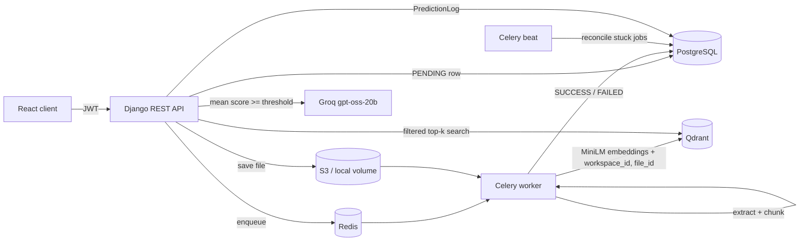

# Arishem

A multi-tenant retrieval-augmented generation (RAG) backend. Teams upload documents
and recordings into isolated workspaces, then ask questions that are answered only
from their own files, with citations. Questions the documents can't answer are
refused on a retrieval-confidence check instead of being answered from the model's
own knowledge.

**Stack:** Django REST Framework · Celery + Redis · Qdrant · sentence-transformers
(`all-MiniLM-L6-v2`) · Groq (`openai/gpt-oss-20b`) · PostgreSQL · S3 · React + TypeScript

[](https://github.com/abhishekkamble12/Arishem/actions/workflows/django.yml)

---

## Measured, not claimed

Every number below traces to a recorded run. Anything not listed has not been
measured, and this README does not claim it.

| | |
|---|---|
| Deployed and tested on AWS | **32/32 checks passed** over the network against a live stack, then torn down — [docs/DEPLOYMENT_VERIFICATION.md](docs/DEPLOYMENT_VERIFICATION.md) |
| Faithfulness (RAGAS) | **1.00** on 28 answered golden-set questions — but saturated; see [Evaluation](#evaluation) |
| Refusal accuracy | **30/30**: all 28 answerable questions answered, both unanswerable ones refused |
| Answer relevancy (RAGAS) | 0.71 answered-only — mostly a length signal here, not quality; see [Evaluation](#evaluation) |
| Tests | 97, all offline (vector store, LLM and S3 faked), 79% line coverage of `app/` + `Services/` |
| Query latency, deployed | **16.0 s** per answered query in agentic mode (3 sequential Groq calls) |
| Tokens per answered query | **1,041 in + 449 out** on the deployed system |
| Deployment cost | **~\$14.69/month** on AWS, from live Pricing API rates — see [docs/DEPLOY.md](docs/DEPLOY.md) |

---

## What it does

| Area | Implementation |
|---|---|
| **Ingestion** | `POST /upload-direct` stores the file under `ws_<id>/<uuid>_<name>`, records it as `PENDING`, enqueues a Celery task and returns `202`. The worker extracts text (PyMuPDF / docx2txt / Unstructured, or Whisper for audio & video), chunks it (800 chars, 150 overlap), embeds it and writes it to Qdrant. |
| **Querying** | The question is embedded and searched in Qdrant, filtered to the caller's workspace. If the mean similarity of the top-k chunks is below a threshold (default 0.065, calibrated on the golden set), the API refuses instead of answering. Otherwise the LLM answers in a JSON schema with citations. In single-pass mode the refusal happens before any LLM call; in agentic mode the decomposition call has already been made, so it skips synthesis and self-critique but is not free. |
| **Agentic mode** (optional) | The LLM splits multi-part questions into sub-queries, retrieves for each, synthesises, then self-critiques the answer against the chunks and retries once if claims are unsupported. Any failure falls back to single-pass RAG. |
| **Multi-tenancy** | One Qdrant collection with an indexed `metadata.workspace_id` payload filter applied on every search. Storage keys are namespaced per workspace. Every file, query and meeting endpoint checks workspace membership. |
| **Roles** | Viewer / Editor / Admin held **per workspace** (`Membership`), so you can be admin of your own project and a viewer on another team's. A sign-up is admin of its own workspace only, and reaches any other workspace solely because that workspace's admin added them. A workspace always keeps one admin. |
| **Sign-in** | Email and password, or Google (One Tap / OAuth 2.0 ID token). Google tokens are verified against `GOOGLE_CLIENT_ID` and rejected unless the address is verified; a matching email links to the existing account. Unset client id means `/auth/google` answers `503` and email sign-in is unaffected. |
| **Consistency** | `PENDING → PROCESSING → SUCCESS/FAILED` state machine. Tasks are idempotent (safe to redeliver), and a Celery Beat job fails anything stuck for more than 30 minutes. Deleting a file removes its vectors, stored object and DB row, in that order. |
| **Cost** | Every query records its LLM call count and prompt/completion tokens on `PredictionLog`; `/app/ai/monitoring` sums them per workspace. The dollar figure is whatever the recorded tokens multiply out to at the rates you configure (`LLM_INPUT_COST_PER_MTOK`, `LLM_OUTPUT_COST_PER_MTOK`), which default to zero so the endpoint never shows an invented price. |
| **Observability** | Every query is logged with latency and confidence. If the rolling mean confidence of the last 50 queries drops below the threshold, a `DriftLog` is recorded and admins are emailed (at most once an hour). |
| **Meeting intelligence** | YouTube URLs or uploaded recordings are transcribed locally with Whisper, then summarised into title, summary, action items, decisions and open questions. |

## Architecture



## Design decisions

**Payload filter instead of a collection per tenant.** One collection per workspace
multiplies index memory and connection overhead as tenants grow. A single collection
with an indexed `workspace_id` filter keeps memory flat. The trade-off is that
isolation depends on the filter always being applied, so it is built in one place
(`Services/agent.py: query`) and covered by a test.

**Refusing on retrieval confidence.** A low mean similarity across the top-k chunks
is a cheap signal that the documents don't cover the question, and refusing beats a
confident-sounding wrong answer. It is also cheaper: measured at 1 call and 307
tokens versus 3 calls and 1,481 for an answered question. Note that only
single-pass mode refuses with no LLM call at all — in agentic mode the decomposition
call precedes the check, so a refusal costs about a fifth of an answer rather than
nothing. The threshold is a blunt instrument: a relevant question phrased very
differently from the source text can score low. It is configurable via
`RAG_CONFIDENCE_THRESHOLD`.

**Database row and vectors are written separately (no distributed transaction).**
The row is created first (`PENDING`) and marked `SUCCESS` only after Qdrant confirms
the write. A failed task leaves `FAILED` with the error message. A crashed worker
leaves the row in flight until the reconciliation job fails it. Re-running a task
first deletes any vectors tagged with that `file_id`, so partial writes can't
duplicate.

**Delete order.** Vectors → stored object → DB row. If the vector delete fails, the
API returns `502` and changes nothing, so the client can retry. Files still being
ingested can't be deleted (`409`), because the worker could write vectors after the
delete.

**Local embeddings.** `all-MiniLM-L6-v2` (384-dim) runs on CPU with no per-call cost
or network hop. A larger hosted model would likely retrieve better. Comparing them
on the eval set is the next experiment.

**A fallback model, not just retries.** Groq retires model ids, and a retired id
fails every call rather than degrading — which is exactly what happened to the
previous default, `llama-3.3-70b-versatile`. Retries inside the client cover 429s
and 5xx; a second model behind `.with_fallbacks()` covers what a retry cannot fix,
and requests carry a timeout so a hung connection cannot hold a worker open.

**Roles per workspace rather than global.** Global roles meant an editor anywhere
was an editor everywhere, and any admin could promote any user on the platform.
Making the role an attribute of the membership is what allows one deployment to
serve unrelated teams. The cost is that a DRF permission class can no longer
decide alone, so every workspace-scoped view resolves the caller's role for the
workspace being acted on (`app/utils.py: resolve_workspace`).

## Evaluation

`evals/run_eval.py` indexes three policy documents (PDF, TXT, MD) into an in-memory
Qdrant using the production chunking settings, runs a 30-question golden set
([`evals/golden_set.json`](evals/golden_set.json)) through the real query pipeline,
and scores the answers with RAGAS. Full results: [`evals/SCORECARD.md`](evals/SCORECARD.md),
per question in [`evals/eval_results.json`](evals/eval_results.json).

| | Answered only (28) |
|---|---|
| Faithfulness | **1.00** |
| Answer relevancy | 0.71 |
| Refusals | 2/30 — exactly the two questions the corpus cannot answer |
| Latency | median 14.7 s, p95 23.2 s |

Generator `openai/gpt-oss-20b`, judge `qwen/qwen3.8-27b` — deliberately a different
model family, so the judge is not grading its own output.

**What the first run found.** It refused **29 of 30** questions, including ones the
corpus answers verbatim, and scored faithfulness 0.00 because almost nothing was
answered. The refusal threshold (0.35) had been inherited from a retired embedding
model. Answerable questions actually score 0.072–0.376 and unanswerable ones
−0.003–0.059, so 0.35 was rejecting nearly everything. The harness now prints a
threshold sweep — retrieval confidence does not depend on the threshold, so one run
gives the whole curve — and the default is 0.065, the midpoint of the gap. That is
fitted on two negative examples, which is thin: widen the golden set before
trusting a more precise value.

**How to read the numbers.** Both need a caveat, and the scorecard prints them:

- **Faithfulness is saturated, and it is real.** A score that never drops below 1.0
  cannot by itself tell "the system does not hallucinate" from "the judge passes
  everything", so [`evals/judge_control.py`](evals/judge_control.py) feeds the same
  judge answers with known defects. It scores a faithful answer 1.00, a fabricated
  one 0.00, a half-fabricated one 0.50 and a wrong figure 0.00. So the 1.0 is
  genuine — but the questions are single-fact lookups over a corpus small enough
  that every query retrieves all of it. It shows the system does not hallucinate on
  easy questions, and says nothing about hard ones.
- **Answer relevancy is mostly measuring length.** It correlates +0.71 with answer
  word count: answers of four words or fewer average 0.29 even though every one is
  correct (`uv` scores 0.086), while longer answers average 0.88. RAGAS scores
  relevancy by regenerating the question from the answer, which a correct one-word
  answer cannot do.
- `context_precision` and `context_recall` are not reported. With four chunks and
  `top_k=5`, every query retrieves the whole corpus, so they have nothing to
  discriminate between.

```bash
pip install -r backend/requirements-optional.txt     # ragas is not a runtime dependency
python evals/run_eval.py                             # generate, cache answers, score
EVAL_REUSE_ANSWERS=1 python evals/run_eval.py        # rescore the cache, no generation
EVAL_REPORT_ONLY=1   python evals/run_eval.py        # rebuild the report, no model calls
python evals/judge_control.py                        # check the judge can fail
```

Generation, scoring and reporting are separate because a free Groq tier caps tokens
per day, and four metrics over 30 questions exhausted it mid-run.

An earlier `SCORECARD.md` in this repo reported faithfulness 0.9231 and three
similar figures. Those were not reproducible: `ragas` was in no requirements file,
Django was never configured so the harness could not even import, the judge model
it named had been retired, and the "PDF" in the corpus was a text file. It was
deleted rather than left to imply a result that was never produced.

## Running it

### Docker Compose

```bash
cp .env.example .env        # SECRET_KEY and GROQ_API_KEY are the only required values
docker compose up --build
curl http://localhost:8000/app/health
```

This starts Postgres, Qdrant, MinIO, Redis, a one-shot migration, the API
(Gunicorn), a Celery worker and Celery Beat.

> **Config gotcha.** The backend reads `backend/backend/.env`, not the repo-root
> `.env`, because python-decouple searches upward from `settings.py` and caches the
> first file it finds. The root `.env` is what `docker compose` reads and injects as
> container environment variables. If a setting seems not to apply outside Docker,
> check `backend/backend/.env` first.

### Local

```bash
cd backend
python -m venv .venv && source .venv/bin/activate   # Windows: .venv\Scripts\activate
pip install -r requirements.txt
cp backend/.env.example backend/.env                # DB_ENGINE defaults to SQLite
python manage.py migrate
celery -A backend worker -l info                    # terminal 2
python manage.py runserver                          # terminal 3

cd ../frontend && npm install && npm run dev
```

## Tests

```bash
cd backend
python manage.py test --settings=backend.test_settings
```

97 tests, all offline: the vector store, LLM and S3 are replaced with fakes, so no
test needs a network call or an API key. CI runs them with coverage on every push
(79% line coverage of `app/` and `Services/`). They cover:

- auth, JWT and per-workspace roles, including that a sign-up cannot grant itself a
  role, that a role in one workspace grants nothing in another, and that a workspace
  cannot be left without an admin
- Google sign-in: account creation, account linking by email, refusal of unverified
  addresses, rejected tokens, and the unconfigured-server case
- tenant isolation for queries, uploads, deletes and meeting analyses
- storage-key namespacing and path-traversal rejection, and that the S3 and local
  backends fail identically for a missing object
- delete ordering and failure behaviour
- refusal logic in both modes: single-pass makes no LLM call below the threshold,
  and agentic refuses after decomposition (`test_low_confidence_refuses_after_decomposition`)
- the ingestion task's success, failure and redelivery paths, and stuck-job
  reconciliation
- the LLM client's timeout, retry and fallback configuration
- token accounting: totals across the calls one query makes, both shapes of usage
  metadata, persistence on `PredictionLog`, and that unset cost rates report \$0.00
  rather than a made-up price

### Verified behaviour

Beyond the offline suite, these were run against real infrastructure on
2026-10-26 (real S3, Qdrant, Postgres and Groq) rather than fakes:

- **28 end-to-end checks passed**: upload to S3, worker retrieval and embedding,
  a grounded answer with correct citations, out-of-domain refusal, cross-tenant
  `403`/`404`, viewer-cannot-upload then promoted-editor-can, and delete removing
  the S3 object. This is where the confidence and latency figures above come from.
- **12 storage checks passed** against a real S3 bucket.
- Migration `0009` (global roles to per-workspace memberships) applied to real
  PostgreSQL and backfilled existing members.

These were one-off runs from a developer machine, not a scheduled job.

## API overview

Viewer / Editor / Admin below mean the caller's role **in the workspace being
acted on**, not a global one.

| Endpoint | Method | Viewer | Editor | Admin |
|---|:---:|:---:|:---:|:---:|
| `/app/auth/register`, `/app/auth/login`, `/app/auth/google` | POST | open | open | open |
| `/app/auth/me`, `/app/auth/workspaces` | GET | ✅ | ✅ | ✅ |
| `/app/auth/workspaces` | POST | ✅ | ✅ | ✅ |
| `/app/auth/workspaces/<id>/members` | GET | ✅ | ✅ | ✅ |
| `/app/auth/workspaces/<id>/members` | POST | ❌ | ❌ | ✅ |
| `/app/auth/workspaces/<id>/members/<user_id>` | PATCH | ❌ | ❌ | ✅ |
| `/app/auth/workspaces/<id>/members/<user_id>` | DELETE | self only | self only | ✅ |
| `/app/ai/query` | POST | ✅ 10/min | ✅ 60/min | ✅ 60/min |
| `/app/ai/files` | GET | ✅ | ✅ | ✅ |
| `/app/ai/upload-direct`, `/app/ai/upload` | POST | ❌ | ✅ | ✅ |
| `/app/ai/files/delete` | DELETE | ❌ | ✅ | ✅ |
| `/app/ai/meetings/ingest-youtube` | POST | ❌ | ✅ | ✅ |
| `/app/ai/meetings/<file_id>/analysis` | GET | ✅ | ✅ | ✅ |
| `/app/ai/monitoring` | GET | ❌ | ✅ | ✅ |
| `/app/health` | GET | open | open | open |

All workspace-scoped endpoints take an optional `workspace_id` and default to the
caller's first workspace. Example query response:

```json
{
  "answer": "API prediction logs must be retained for 90 days.",
  "citations": [{"source": "SOP-104_Data_Retention_Policy.pdf",
                 "snippet": "All API prediction logs ... must be retained for exactly 90 days."}],
  "sources": ["SOP-104_Data_Retention_Policy.pdf"],
  "confidence": 0.73,
  "agentic_mode": false
}
```

## Deployment

[`deploy/cloudformation.yml`](deploy/cloudformation.yml) puts the whole system on one
small EC2 instance with Docker Compose, documents in S3, and Caddy terminating TLS.

```powershell
./deploy/deploy.ps1 -AlertEmail you@example.com
```

About **\$14.69/month** in ap-south-1, from live Pricing API rates. It deliberately
leaves out what usually dominates an AWS bill and earns nothing at one instance: no
load balancer (~\$16/mo), no NAT gateway (~\$32/mo), no RDS, no ElastiCache. Secrets
live in SSM Parameter Store, the instance role grants S3 on its own bucket only,
there is no SSH port (Session Manager instead), and a budget alarm emails at 80% of
a limit you set. The stack reports success only once the API answers its own health
check. Full breakdown and teardown steps: [docs/DEPLOY.md](docs/DEPLOY.md).

The template is validated (`validate-template` and `cfn-lint`, no findings) but
**has not been deployed**, so there is no live demo URL yet.

## Known limitations

- **The evaluation set is too easy.** Faithfulness is at its ceiling because every
  question is a single-fact lookup over four chunks. It needs multi-hop questions, a
  larger corpus where retrieval actually has to choose, and many more unanswerable
  questions before it can tell a good change from a bad one. This is the biggest gap.
- **No prompt-injection guard.** A document can carry instructions into the prompt.
- The refusal threshold (0.065) is fitted on 28 answerable and only 2 unanswerable
  questions. The gap it sits in is real but narrow (0.059 to 0.072).
- 16 s per answer is slow for a chat interface. The cause is agentic mode's three
  sequential LLM calls; single-pass mode is roughly a third of that, with its
  quality cost not yet measured.
- Drift checking runs inside the query request. It should move to a Celery task.
- Retrieval is dense-only. Hybrid BM25 + vector search or a reranker would help
  keyword-heavy questions.
- No load testing, so there are no throughput numbers.
- One instance with no backups: a reboot is downtime, and the Postgres and Qdrant
  volumes have no snapshot schedule.

## License

MIT — see [LICENSE](LICENSE).
